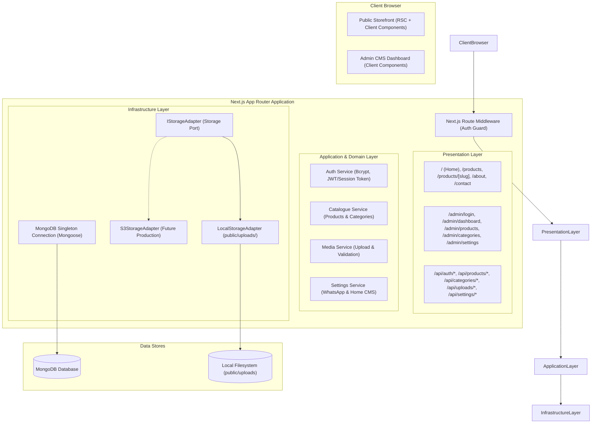

# System Architecture Specification
# Project: Women's Jewellery & Ornaments Catalogue

## 1. Architectural Approach
The application is architected as a **Modular Monolith** using the Next.js App Router (React Server Components + API Route Handlers) backed by MongoDB. This combines high performance, zero-microservice complexity, unified TypeScript types across client and server, and simplified deployment.



---

## 2. Directory Layout & Organization
```text
jewellery-store/
├── src/
│   ├── app/                         # Next.js App Router
│   │   ├── (storefront)/            # Public storefront route group
│   │   │   ├── layout.tsx           # Storefront layout (Header, Nav, Footer)
│   │   │   ├── page.tsx             # Homepage
│   │   │   ├── products/
│   │   │   │   ├── page.tsx         # Product listing & faceted filter
│   │   │   │   └── [slug]/
│   │   │   │       └── page.tsx     # Product detail & WhatsApp link
│   │   │   ├── about/page.tsx       # About brand & craftsmanship
│   │   │   ├── contact/page.tsx     # Contact & showroom info
│   │   │   └── sitemap.xml/route.ts # Dynamic XML sitemap
│   │   ├── admin/                   # Back-office admin route group
│   │   │   ├── login/page.tsx       # Secure admin login
│   │   │   ├── layout.tsx           # Admin authenticated dashboard shell
│   │   │   ├── page.tsx             # Dashboard metrics overview
│   │   │   ├── products/            # Product CRUD pages
│   │   │   ├── categories/          # Category CRUD pages
│   │   │   └── settings/            # WhatsApp & Homepage settings
│   │   ├── api/                     # Internal API route handlers
│   │   │   ├── auth/                # Login, logout, session check
│   │   │   ├── products/            # Public & admin product endpoints
│   │   │   ├── categories/          # Public & admin category endpoints
│   │   │   ├── uploads/             # File upload handler
│   │   │   └── settings/            # Settings read/update
│   │   ├── globals.css              # Global luxury typography & Tailwind styles
│   │   └── layout.tsx               # Root HTML document layout
│   ├── components/
│   │   ├── ui/                      # Base luxury UI components (Button, Modal, Input)
│   │   ├── storefront/              # Header, Footer, Hero, ProductCard, Gallery, WhatsAppButton
│   │   └── admin/                   # Sidebar, StatCard, DataTable, ImageUploader, ProductForm
│   ├── lib/
│   │   ├── db/                      # MongoDB client & Mongoose models
│   │   ├── storage/                 # IStorageAdapter & LocalStorageAdapter
│   │   ├── auth/                    # Session management, token sign/verify, password hashing
│   │   └── whatsapp/                # WhatsApp link formatter
│   └── types/                       # Shared domain TypeScript interfaces
├── public/
│   └── uploads/                     # Local persistent media storage
├── scripts/
│   └── seed.ts                      # Demonstration data seeder
└── docs/                            # Specifications and guides
```

---

## 3. Storage Abstraction Pattern
To adhere to the corporate starter kit framework:
- The domain and application logic interact strictly with the `IStorageAdapter` interface.
- For local demonstration, `LocalStorageAdapter` writes uploaded files directly to `public/uploads/` using crypto-random UUID keys and serves them via `/uploads/<key>`.
- For production, an S3/R2 adapter can be swapped with zero modification to product or category management business logic.

---

## 4. Cache & Data Freshness Strategy
1. **Server-Side Rendering with On-Demand Revalidation**:
   - Public product pages and category views use dynamic data fetching or on-demand revalidation.
   - When an administrator creates, updates, publishes, or deletes a product or category in the CMS, Next.js `revalidatePath('/products')`, `revalidatePath('/products/[slug]')`, and `revalidatePath('/')` are executed immediately.
   - Prevents stale cache issues during client demonstrations.

